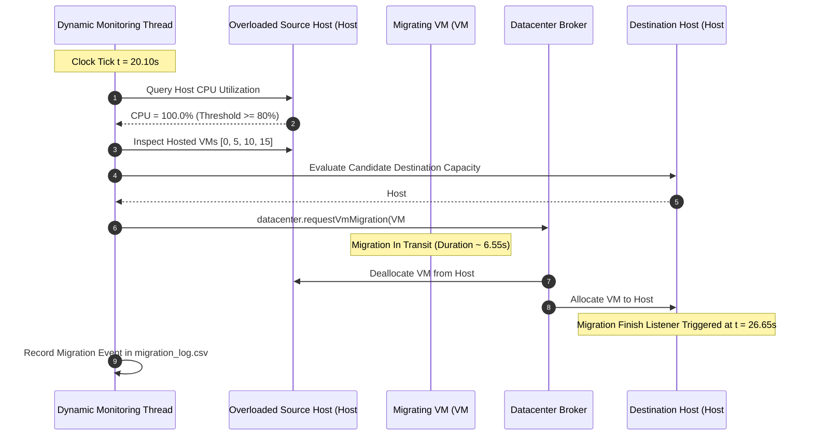

# Architecture Documentation: Static vs Dynamic Resource Allocation in Cloud Computing Using CloudSim Plus

## 1. System Overview

This project provides an academic, reproducible simulation environment comparing **Static Resource Allocation** against **Dynamic CPU-based Resource Allocation with Whole-VM Live Migration** using **CloudSim Plus (v8.5.7)**.

```
                          +-------------------------+
                          |   Workload Generator    |
                          | (E1-E5, Hotspot Waves)  |
                          +------------+------------+
                                       |
                   +-------------------+-------------------+
                   |                                       |
                   v                                       v
     +--------------------------+            +--------------------------+
     | Static Allocation Policy |            | Dynamic Allocation Policy|
     | (Fixed Initial Mapping)  |            | (Overload Monitor + Mig) |
     +-------------+------------+            +-------------+------------+
                   |                                       |
                   | 5 Hosts, 20 VMs                       | Periodic 10s checks
                   | Zero Migration                        | Threshold > 80%
                   |                                       | Whole-VM Live Migration
                   v                                       v
     +------------------------------------------------------------------+
     |                    Metrics Collector & Exporter                  |
     | (Interval Metrics, Task Latency, Migrations, Summary Stats)      |
     +---------------------------------+--------------------------------+
                                       |
                                       v
                   +-------------------+-------------------+
                   |   CSV Data Files (results/*.csv)      |
                   +-------------------+-------------------+
                                       |
                                       v
                   +-------------------+-------------------+
                   | Streamlit & Plotly Analytics Dashboard|
                   +---------------------------------------+
```

---

## 2. Infrastructure Specifications

The simulated datacenter features a homogeneous physical architecture hosting heterogeneous, time-varying multi-tenant workloads.

### Physical Host Configuration (5 Physical Hosts)
- **Host Count**: 5 physical nodes (`Host #0` to `Host #4`).
- **Processing Elements (PEs)**: 8 physical cores per host.
- **Core Processing Speed**: 2,500 MIPS per core (Total capacity: 20,000 MIPS per host).
- **RAM**: 32,768 MB (32 GB) per host.
- **Storage**: 1,000,000 MB (1 TB).
- **Network Bandwidth**: 10,000 Mbps (10 Gbps).
- **VM Scheduler**: `VmSchedulerTimeSharedOvercommit` — custom subclass extending CloudSim Plus `VmSchedulerTimeShared` to allow virtual CPU overcommitment across physical cores, replicating real-world hypervisor scheduling (e.g., VMware ESXi, KVM).
- **Power Model**: `PowerModelHostSimple` (Max power: 250W, Static power: 140W).

### Virtual Machine Configuration (20 Virtual Machines)
- **VM Count**: 20 virtual instances (`VM #0` to `VM #19`).
- **Initial Placement**: Round-Robin across 5 hosts (4 VMs per host):
  - `Host #0`: `VM #0`, `VM #5`, `VM #10`, `VM #15`
  - `Host #1`: `VM #1`, `VM #6`, `VM #11`, `VM #16`
  - `Host #2`: `VM #2`, `VM #7`, `VM #12`, `VM #17`
  - `Host #3`: `VM #3`, `VM #8`, `VM #13`, `VM #18`
  - `Host #4`: `VM #4`, `VM #9`, `VM #14`, `VM #19`
- **vCPUs (PEs)**: 2 cores per VM.
- **Processing Power**: 2,500 MIPS per core (5,000 MIPS total per VM).
- **RAM**: 4,096 MB (4 GB) per VM.
- **Storage (Image Size)**: 10,000 MB.
- **Bandwidth**: 1,000 Mbps (1 Gbps).
- **Cloudlet Scheduler**: `CloudletSchedulerTimeShared`.

---

## 3. Allocation Policies & Mathematical Formulations

### 3.1 Host CPU Utilization Formulation

At any simulation timestamp $t$, the CPU utilization of physical host $h$ is computed as:

$$U_{cpu}(h, t) = \frac{\sum_{v \in V_h(t)} MIPS_{used}(v, t)}{MIPS_{total}(h)}$$

Where:
- $V_h(t)$ is the set of active VMs residing on host $h$ at time $t$.
- $MIPS_{used}(v, t)$ is the current CPU processing rate demanded by VM $v$.
- $MIPS_{total}(h) = \text{PEs}(h) \times MIPS_{pe} = 8 \times 2,500 = 20,000\text{ MIPS}$.

### 3.2 Static Allocation Policy
Under static allocation:
- Initial placement assigns $VM_i$ to $Host_{i \pmod 5}$.
- $V_h(t) = V_h(0)$ for all $t \in [0, T_{sim}]$.
- No runtime reconfiguration or migration takes place. When localized load spikes occur on VMs allocated to a particular host, that host reaches 100% saturation and tasks experience queueing delays.

### 3.3 Dynamic Allocation Policy (Whole-VM Live Migration)

Every monitoring interval $\Delta t = 10\text{ seconds}$:
1. **Overload Detection**: Host $h$ is classified as overloaded if:
   $$U_{cpu}(h, t) \ge \theta_{upper} \quad (\theta_{upper} = 0.80)$$
2. **Migration Candidate Selection**:
   - Filter active VMs on host $h$ excluding VMs currently in transit (`v.isInMigration()`).
   - Select candidate VM $v^* = \arg\max_{v \in V_h(t)} MIPS_{used}(v, t)$.
3. **Feasible Destination Host Identification**:
   - Find destination host $d \ne h$ such that:
     $$U_{cpu}(d, t) + \frac{MIPS_{demand}(v^*)}{MIPS_{total}(d)} < \theta_{upper}$$
     $$\text{RAM}_{avail}(d) \ge \text{RAM}(v^*)$$
4. **Live Migration Execution**:
   - Issue CloudSim Plus migration request: `datacenter.requestVmMigration(v*, d)`.
   - Migration transfer time is modeled based on VM RAM and host network bandwidth:
     $$T_{mig} = \frac{\text{RAM}(v^*) \times 8}{\min(BW_h, BW_d)} = \frac{4096 \times 8}{10000} \approx 6.55\text{ seconds}$$
   - Verified via `addOnVmMigrationFinishListener`.



---

## 4. Workload Generation Profiles

The Workload Generator creates 500 computational tasks (cloudlets) per scenario under identical seeds for both policies:

| Scenario ID | Name | Description | Target Demand |
|:---|:---|:---|:---|
| **E1** | Low & Stable | Baseline low load evenly distributed | 20% - 30% |
| **E2** | Increasing Workload | Load ramps linearly from low to high | 30% $\rightarrow$ 80% |
| **E3** | Peak Workload | Sustained high computational bursts | 80% - 95% |
| **E4** | Peak & Recovery | Phased: Low $\rightarrow$ Ramp $\rightarrow$ Peak $\rightarrow$ Recovery | 25% $\rightarrow$ 80% $\rightarrow$ 95% $\rightarrow$ 35% |
| **E5** | Mixed / Random | Stochastic bursts and localized hotspots | Random spikes |
| **HOTSPOT** | Controlled Hotspot | Synchronous waves targeting Host 0's VMs | Host 0 @ 100% saturation |

---

## 5. Metrics & Validation Rules

- **Average CPU Utilization**: Aggregate arithmetic mean across all physical hosts.
- **Peak CPU Utilization**: Maximum observed single-host CPU utilization.
- **Response Time**: $\text{Finish Time} - \text{Arrival Time}$.
- **Throughput**: Completed cloudlets per second over observation windows.
- **SLA Violations**: Count and percentage of cloudlets whose response time exceeds $\tau_{SLA} = 500\text{ ms}$.
- **Migration Count**: Total number of completed whole-VM migrations verified by the hypervisor listener.
